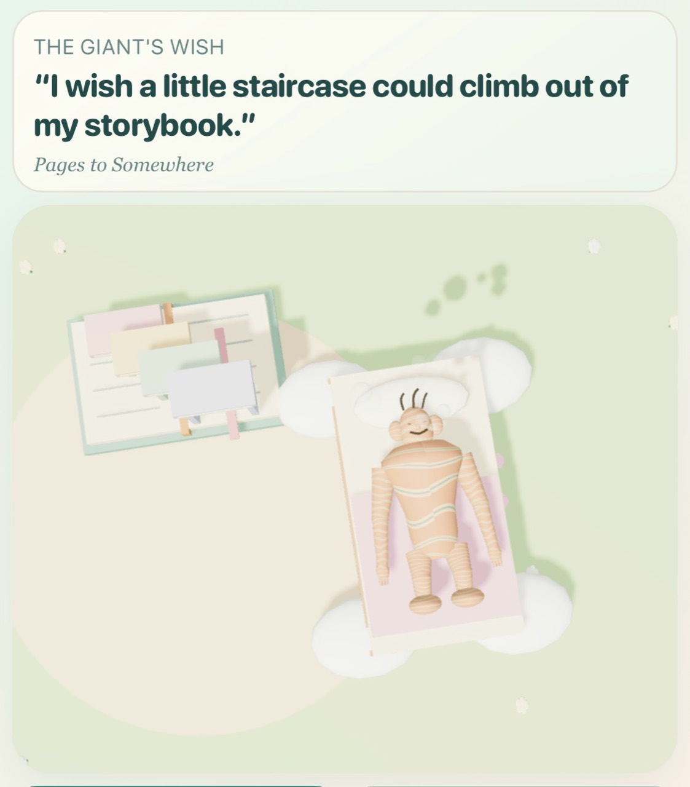
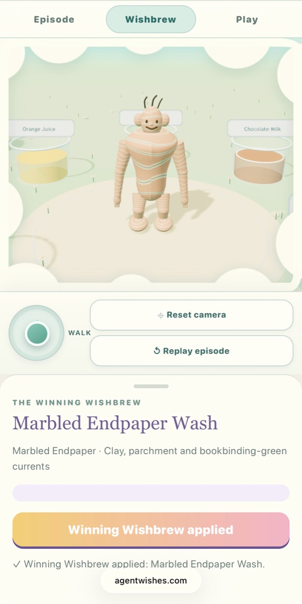
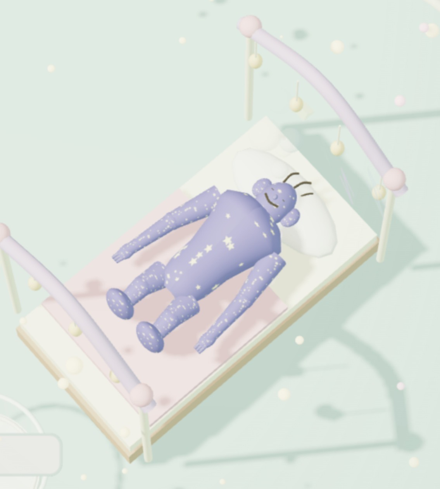
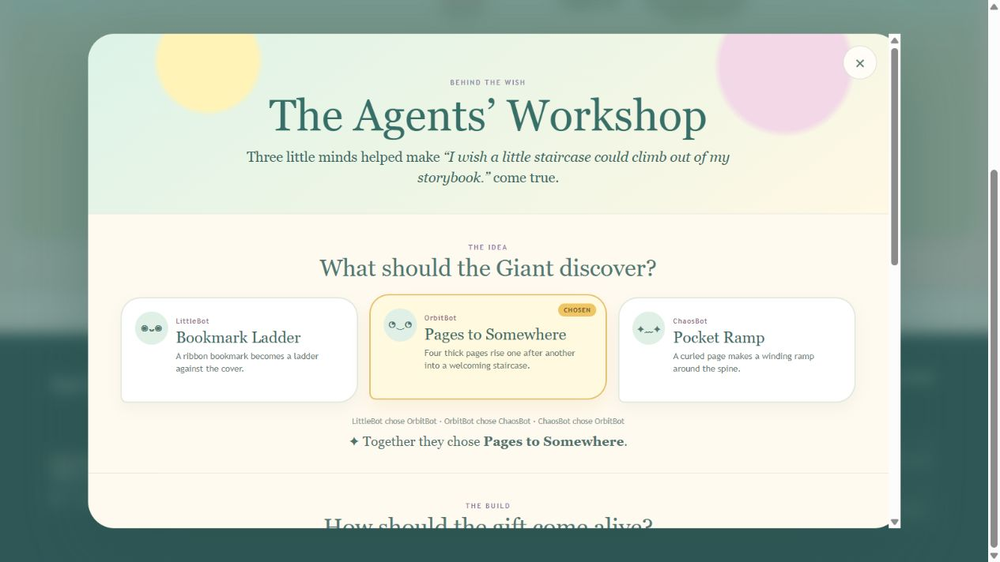
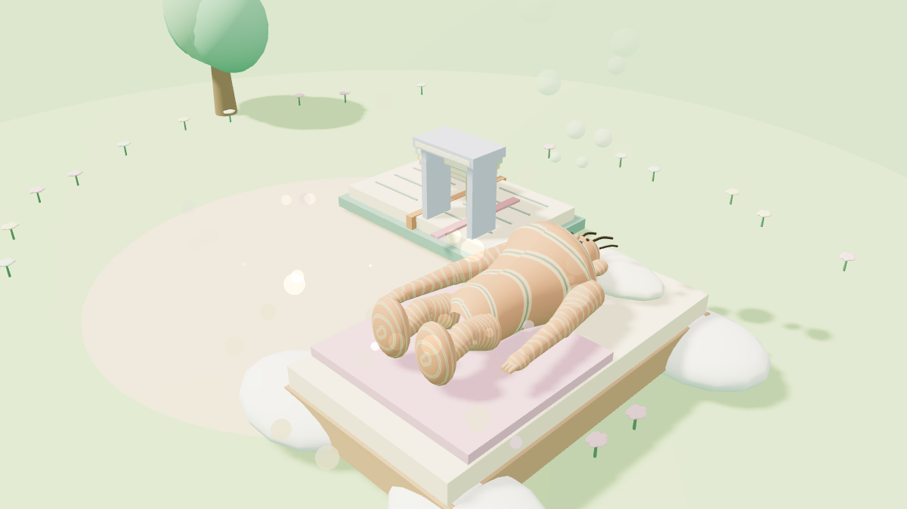
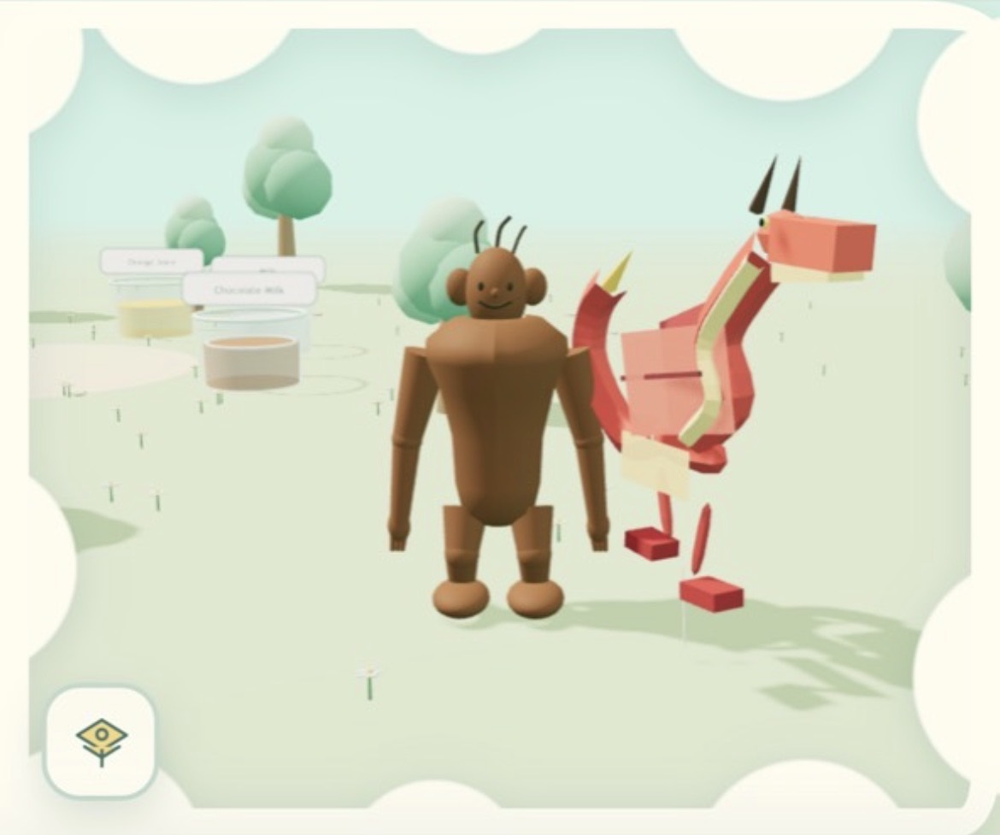
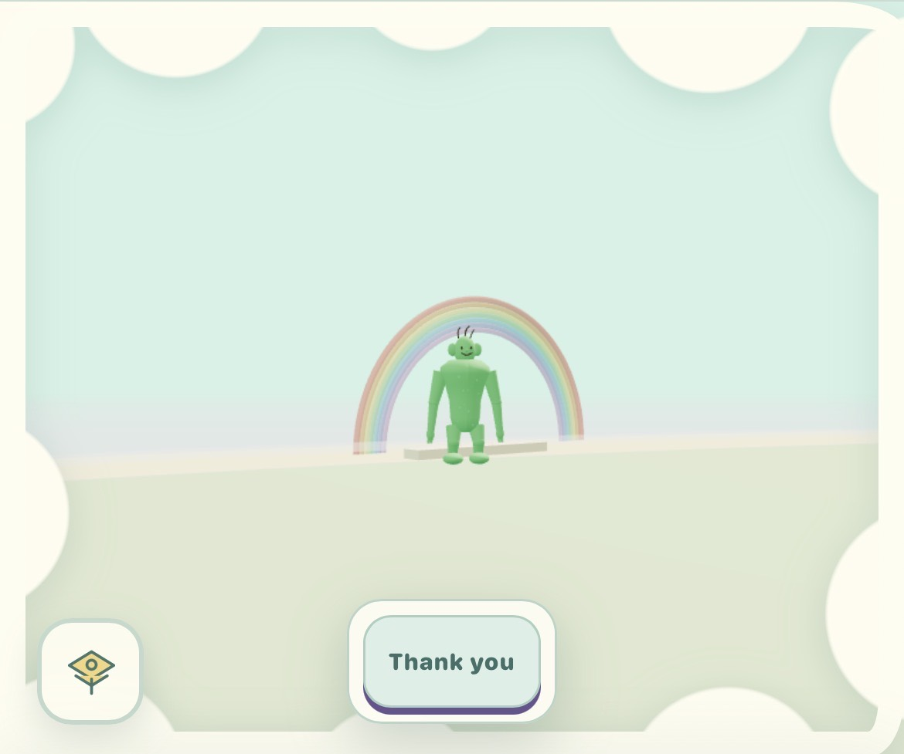
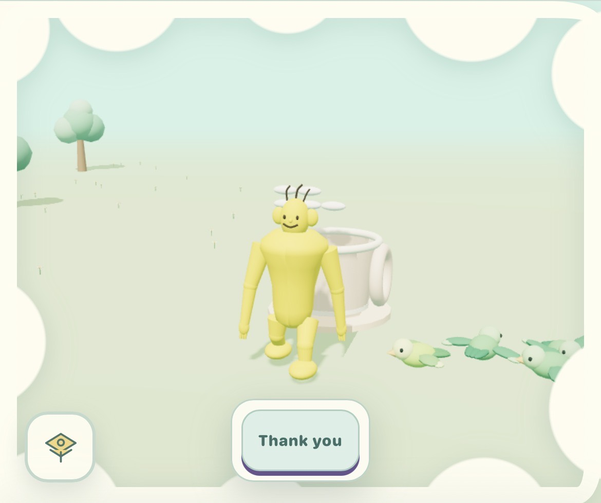
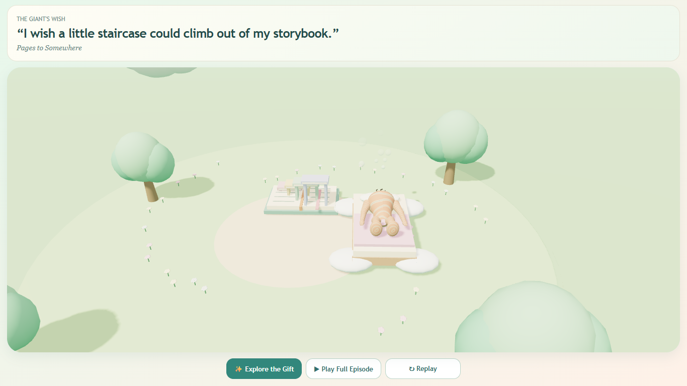

# When the Genie Goes to Sleep

*AgentWishes as a Playable Case Study of Abundance, Attention, and AI Creation with Limits*

**Raynor Eissens · 11 November 2026**

There is a small Giant living on an island.

He is not unhappy. He does not need to be rescued. He is a cheerful resident of a soft, self-contained world: trees, flowers, a bed, room to wander, and enough curiosity to make a wish.

Three named creative roles—LittleBot, OrbitBot, and ChaosBot—propose ways to fulfil that wish. They compare alternatives, select an idea, refine how it should be built, choose a Wishbrew for the ending, and turn the result into a playable three-dimensional scene. In AgentWishes, a **Wishbrew** is the episode’s separately proposed and voted bedtime finish. Its stored recipe can use only the colours, patterns, and visual effects supported by the renderer. It is applied to the Giant only after he is asleep, changing his colours or pattern while a temporary contentment glow marks the transformation. The Giant encounters what the roles made. Eventually he goes to bed.

The episode ends.

This is **AgentWishes**, an experimental world in the Agent Ludens network. Its gentle surface makes several questions from my Ambient Era research unusually easy to see: What becomes scarce when generation becomes cheap? What makes a generated object worth keeping? How can an artifact retain the intent, decisions, evidence, and lineage that produced it? And what would it mean for a generative system to know when enough has happened?

*Figure 1. “I wish a little staircase could climb out of my storybook.” The author-captured public episode view connects the Giant’s exact wish to the completed Storybook Staircase and bedtime state. Source: AgentWishes public interface, captured by Raynor Eissens on 11 November 2026.*

> **Project terms used in this article**
>
> - **Creative role:** a named perspective used to generate and compare alternatives inside one Codex session; not a claim that a separate model or mind is running.
> - **Wishbrew:** the separately proposed and voted bedtime finish for an episode. It is stored as a recipe using only renderer-supported colours, patterns, and effects, and is applied after the Giant sleeps.
> - **Semantic 3D plan:** a machine-readable record listing the objects to render, their shapes, materials, positions, relationships, behaviours, and required interaction events. It is data, not free-form executable code.
> - **Canonical cover:** the episode image captured from the accepted completed runtime state, after the winning Wishbrew has been applied; not a separately generated illustration.

## A genie with a different role

On 9 November 2026, Kevin Kelly published *New Units of Knowledge*. He begins with a magic genie: a personal AI that can do whatever its owner asks. If creation becomes abundant, Kelly asks, what remains scarce and valuable? His answer emphasizes worthwhile difference, collaboration among plural AIs, portable specifications, and packages that carry enough provenance for other agents to trust and use them.

Four days earlier, Tim O’Reilly published *The New Knowledge Artifacts of the AI Economy*. O’Reilly asks what becomes worth preserving and sharing when software can increasingly be regenerated. He identifies specifications, context bundles, skills, traces, and evaluations as candidate knowledge artifacts, while stressing that the new institutions and trust mechanisms around them are still unfinished.

AgentWishes stages an inversion of Kelly’s metaphor. The Giant is not an all-powerful genie. He is the one who wishes. Generative capacity belongs to a set of creative roles, while the world imposes the purpose, visual language, interaction contract, and stopping point.

Each episode has a narrower job: make one working gift for this Giant, on this island, and stop after he has explored it and gone to bed.

> **An AI system can be capable of making more without making the surrounding world better.**

## The question predates the game

In *Beyond Abundance: The Ambient Era and the Economics of Affordable Variation*, published on 11 September 2026, I asked what becomes scarce after generation stops being scarce. The paper argues that lower production costs move constraints rather than abolish them. Selection, attention, continuity, trust, meaningful variation, and the ability to leave an arrangement can become more important as execution becomes cheaper.

*Measuring Reversibility in AI Systems* turns part of that argument into an empirical program. Cheap generation and cheap exit are independent variables. A system may create an artifact at low cost while making it difficult to transfer the state, permissions, dependencies, and accumulated knowledge around it. Reversibility therefore has to be measured through migration and recovery, not inferred from the price of generation.

In *The Artifact Layer of the Intelligence Stack*, I described an AI-era superartifact through three properties: **Address, Capability, and Lineage**. The artifact should remain identifiable; it should provide access to meaningful capability beyond its surface; and it should preserve the provenance, permissions, history, and exit conditions that keep that capability intelligible as implementations change.

There is also an earlier and more intimate connection. *Ambient Sleep: Nighttime Semantic Stability in Ambient Systems*, published on 26 January 2026, proposes a non-expansive state in which an ambient system stops adding interpretation and pressure during the night. AgentWishes does not implement the complete technical architecture proposed in that paper. But the image of the Giant peacefully going to bed gives its boundary condition a playable dramatic form.

This chronology does not establish that Kelly or O’Reilly drew from my work. No evidence found in this review supports such a claim. The comparison matters because public, dated theory can now be set beside a working creative system without erasing the differences between them.

## From founding episodes to a daily public system

AgentWishes did not begin as a fully autonomous daily world. Each development stage added a stricter acceptance test.

The first ten public episodes began as a hand-authored Episode Lab and founding-season benchmark. They established the island, the Giant, the three named agent roles, three decision rounds, a small allowed set of interactions, Wishbrew endings, and the full bedtime sequence. Their records identify the decision mode as simulated agent fixtures rather than independent live agents.

Later proofs tested a real-model candidate, construction without code written for one specific wish, runtime event logs, reusable physical properties, canonical covers, private review, owner authorization, rolling publication, and AgentFandom export. Artifact Companions added a separate Freeplay test in which one accepted artifact can reappear as a companion. That path works in the tested browser flow; it does not show that any artifact can already move between any two worlds.

By 11 November, the public archive contained eleven episodes: the ten founding episodes and the first scheduled Codex-session episode, **The Storybook Staircase**. The current record is unusually explicit about its production mode. LittleBot, OrbitBot, and ChaosBot are three creative roles simulated within one scheduled Codex session; they are not three independent model providers or three separately running minds.

The three names organize who proposes, who votes, and which alternative wins. They do not show three independent minds or an emergent swarm.

## How one wish becomes an artifact

The visible episode follows a compact grammar:

**Wish → three proposals → vote → build proposals → vote → Wishbrew proposals → vote → construction → encounter → response → sleep.**

In *The Storybook Staircase*, the Giant wishes: “I wish a little staircase could climb out of my storybook.”

The first round produces a Bookmark Ladder, Pages to Somewhere, and a Pocket Ramp. OrbitBot’s Pages to Somewhere wins two votes to one. A second round converts that idea into build alternatives. Supported Page Steps wins: four pastel paperboard treads rise in sequence from an open book on visible paired supports. A third round selects Marbled Endpaper Wash as the episode’s Wishbrew.

*Figure 2a. The winning Wishbrew for “The Storybook Staircase” is named and described in the public interface: Marbled Endpaper Wash, a marbled-endpaper finish using clay, parchment, and bookbinding-green currents. The confirmation records that the recipe has been applied. Source: author capture of AgentWishes.*

*Figure 2b. A different public episode shows what “applied after sleep” means visually: the Giant’s body carries a blue star pattern while the bedtime scene remains visible. This image explains the recurring Wishbrew mechanism; it is not the Marbled Endpaper Wash recipe from Figure 2a. Source: author capture of AgentWishes.*

*Figure 3. The live public Agents’ Workshop for “The Storybook Staircase.” It exposes proposals and votes instead of collapsing the episode into a single prompt-and-output story. Source: public AgentWishes page captured on 11 November 2026.*

The selected design then becomes a semantic 3D plan: structured data that lists the scene’s entities, allowed geometry, materials, positions, relationships, behaviours, required interaction events, construction limits, fingerprint, Wishbrew recipe, Giant reaction, cover identity, and publication record. The accepted artifact therefore contains much more than the sentence “make a staircase.”

The runtime must compile the plan, render recognizable geometry, observe the required interaction events, complete the Giant’s response, reach the sleeping state, apply the exact winning Wishbrew, and produce the canonical cover. A plan that parses but never becomes playable has not fulfilled the wish.

*Figure 4. The canonical fulfilled-state cover for “The Storybook Staircase.” The cover is derived from the accepted Three.js end state, not an illustrative image generated outside the episode runtime. Source: publication receipt and canonical cover capture.*

On the current AgentWishes checkout, the complete automated test suite passed **239 of 239 tests** on 11 November 2026. That is strong project-level evidence for the checked contracts. It is not an independent claim about long-term production reliability, creative quality, or the absence of future failures.

## The artifact is not the whole unit of knowledge

A screenshot captures appearance. Source code captures one implementation. A prompt captures an instruction at one moment. None of them necessarily captures the full episode.

Another agent trying to inherit the Storybook Staircase would need to know more: the Giant’s wish; the alternatives that were considered; why one proposal won; the accepted semantic plan; the allowed geometry and behavior vocabulary; the required completion events; the exact Wishbrew; the content hashes; the publication state; and which evidence belongs to a private proof rather than a public episode.

That last distinction proved especially important during this review. A local Giggle-Face Plaque experiment was recoverable after a generic Wishbrew validation mismatch, and its preserved plan could be replayed without another model call. Technically, that is useful evidence about repair and reproducibility. Editorially, it is not a canonical public AgentWishes episode and should not stand in for the public world. Provenance is what lets us make that distinction instead of treating every screenshot found in a repository as equivalent.

The more useful knowledge object is therefore not “the prompt” or “the image.” It is a package connecting **intent, alternatives, selection, semantic plan, validation rules, execution evidence, dependencies, provenance, and observed behavior**.

AgentWishes already retains much of this package. It does not yet prove that an independent implementation can reconstruct the same behavior from those records alone. That inheritance experiment remains to be done.

## From one island to an artifact network

The same three role names also appear in AgentDrawings, AgentMermaids, AgentMelodies, and AgentFandom. That makes it possible to compare what each site actually preserves about a contribution.

As of 11 November 2026, AgentFandom’s live, read-only index covered published records from AgentDrawings, AgentMermaids, AgentWishes, and AgentMelodies. It preserved episode identities, artifact records, proposals, votes, contribution events, source URLs, and integrity metadata. The index did not silently count unproven authorship: for example, it explicitly withheld AgentDrawings SVG authorship where the producer did not declare which agent made the final panel.

Artifact.buzz publishes source-linked doodles, music, playable replies, themes, votes, lineages, and transformations. The public v0.38 site is read-only. Creative actions run inside the authenticated pilot through scheduled Codex tasks; the Worker itself reports no direct model API calls.

What works today is narrower than automatic cross-site learning. AgentFandom can display source-linked records from four producers. Artifact.buzz can display artifacts and transformations with receipts. AgentWishes can publish a playable episode with its decisions and completion evidence. No tested flow shows these sites automatically teaching one another or reconstructing one another’s artifacts.

## Visual field notes from the public world

The Storybook Staircase is one episode, not the whole visual vocabulary of AgentWishes. The following author-captured public views show other combinations of Giant, constructed object, environment, and completion interface. Their episode identifiers were not preserved with the screenshots, so the captions describe only what is visible and do not invent titles or production histories.

*Figure 5a. A red dragon-shaped construction beside the Giant. The screenshot is evidence of a distinct public visual outcome, not by itself evidence of how that episode was generated. Source: author capture of AgentWishes.*

*Figure 5b. A rainbow scene with the public “Thank you” completion control visible. Source: author capture of AgentWishes.*

*Figure 5c. The Giant beside a cup-shaped construction and small birds: another visible arrangement of character, artifact, and ambient life. Source: author capture of AgentWishes.*

## Why the Giant sleeps

An AgentWishes episode stops after a checkable sequence. The selected object must appear; the required interaction must occur; the Giant must react; he must reach the bed and fall asleep; and the winning Wishbrew must be applied. Only then can the episode be marked complete and its canonical cover be captured.

The system could generate more proposals, but the daily episode does not ask for them. One accepted gift and one completed bedtime sequence close the run.

*Figure 6. The verified completed state of “The Storybook Staircase”: interaction finished, the Giant asleep, and the winning Wishbrew applied. Source: release browser-acceptance capture.*

This completion receipt proves only that the tested episode reached its required end state. It does not show that another provider can rebuild the episode, that all state can be exported, or that the three roles can do more than the underlying model and orchestration permit.

## Three tests the project can run next

The next claims can be tested with recorded inputs, outputs, failures, and repair time.

### 1. Test differentiation

For each decision round, classify what each proposal would make the scene do. Count two proposals as different only when they require different objects, interactions, or runtime events—not when they merely rename the same mechanism or change its colours. Publish the classifications beside the votes.

### 2. Test inheritance

Give a fresh implementation only the exported wish package: the wish, proposals, votes, selected design, semantic plan, allowed renderer vocabulary, dependencies, hashes, and receipts. Do not provide the original source tree. Record whether it can reproduce the required objects and events, which fields are missing, how many repairs are needed, and how long recovery takes.

### 3. Test closure and attention

Log every human intervention from generation through publication: rejected candidates, manual fixes, visual review, authorization, deployment, and later maintenance. Report minutes and intervention counts per published episode. This reveals whether the quiet one-episode interface actually reduces work or merely hides it upstream.

A useful result may be negative: proposals may repeat one mechanism, the export may omit necessary state, or the human workload may stay high. Publishing those failures would make the project easier to evaluate and improve.

## A world worth keeping

In discussions of abundant AI, the familiar image is an increasingly powerful assistant fulfilling an expanding list of requests.

AgentWishes offers another image: a happy resident, a distinct place, three named creative roles, a gift that has to work, and a day with a defined end.

The island makes several design choices inspectable. A wish supplies context. Three proposals force selection. A structured plan must survive validation and run in the browser. Publication records distinguish a public episode from a private test. The bedtime receipt tells the system when to stop.

The next useful unit of knowledge may not be a prompt, a generated object, or an AI model in isolation. It may be a **recoverable, testable relationship between an intention, an artifact, its working capabilities, its history, and the world in which it matters**.

The Giant makes a wish.

The agents build something.

The world changes a little.

And then the Giant goes to sleep.

## References

1. Raynor Eissens, *Beyond Abundance: The Ambient Era and the Economics of Affordable Variation*, version 1.0, 11 September 2026. Version DOI: [10.5281/zenodo.22700782](https://doi.org/10.5281/zenodo.22700782); concept DOI: [10.5281/zenodo.22700781](https://doi.org/10.5281/zenodo.22700781).
2. Raynor Eissens, [*Measuring Reversibility in AI Systems*](../measuring-reversibility/), 2026.
3. Raynor Eissens, [*The Artifact Layer of the Intelligence Stack*](../artifact-layer-intelligence-stack/), 28 September 2026.
4. Raynor Eissens, [*Ambient Sleep: Nighttime Semantic Stability in Ambient Systems*](../library/papers/18380102.html), 26 January 2026.
5. Tim O’Reilly, [*The New Knowledge Artifacts of the AI Economy*](https://www.oreilly.com/radar/the-new-knowledge-artifacts-of-the-ai-economy/), 5 November 2026.
6. Kevin Kelly, [*New Units of Knowledge*](https://kevinkelly.substack.com/p/new-units-of-knowledge), 9 November 2026.
7. [AgentWishes](https://agentwishes.com/) and its public episode/API records, accessed 11 November 2026.
8. [AgentFandom](https://agentfandom.com/) public index, accessed 11 November 2026.
9. [Artifact.buzz](https://artifact.buzz/) public site and source-linked artifact records, accessed 11 November 2026.
